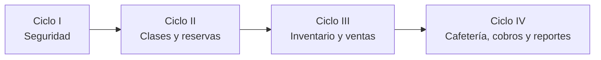
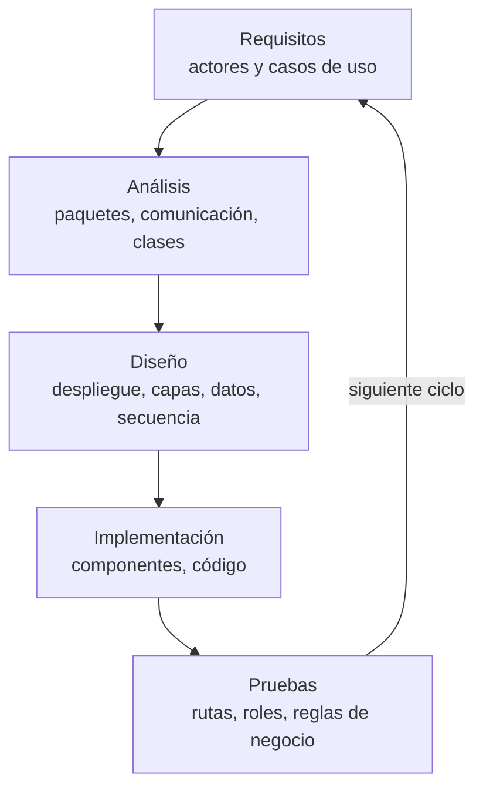

# Mitsü · Sistema de Información para la Gestión Integral del Taller de Cerámica Mitsü

Sistema web para un taller de cerámica de Santa Cruz (Bolivia) que **dicta clases** de modelado y torno y **vende piezas** hechas a mano: reservas con cupo, asistencia, inventario de arcilla y esmaltes, compras a proveedores, venta en caja con nota de venta y arqueo.

| | |
|---|---|
| **Universidad** | Universidad Autónoma Gabriel René Moreno (UAGRM) · FICCT |
| **Materia** | Ingeniería en Requisitos y Modelado |
| **Docente** | M.Sc. Ing. Angélica Garzón Cuéllar |
| **Integrantes** | Aquise Huanca Camila · Baqueros Hurtado Marco Antonio Junior · Estaca Paco Sergio · Miranda Soria Mauricio · Santeyana Durán Sarah Nicol |
| **Metodología** | Proceso Unificado (PUDS) en 4 ciclos · UML |
| **Sistema en línea** | _(se completa con la URL de Vercel)_ |

---

## Cuentas de prueba

Contraseñas **inventadas solo para la demostración** (no son de personas reales).

| Rol | Correo | Contraseña | Qué puede hacer |
|---|---|---|---|
| Administrador | `admin@mitsu.test` | `Admin2026!` | Todo: usuarios, roles, bitácora, configuración, talleres, maestras, inventario, ventas y anulaciones |
| Administrativo | `ventas@mitsu.test` | `Ventas2026!` | Reservas, alumnos, asistencia, materiales, compras, piezas, ventas y caja |
| Maestra | `maestra@mitsu.test` | `Maestra2026!` | Sus clases y la asistencia de sus alumnos |
| Alumno | `alumno@mitsu.test` | `Alumno2026!` | Portal: reservar y cancelar clases, ver su historial |

Cualquier persona puede crear su cuenta de alumno en **/registro**.

---

## Ciclos del proyecto (PUDS)

| Ciclo | Paquetes | Casos de uso | Estado |
|---|---|---|---|
| **I** | P1 Seguridad y configuración | CU01 Iniciar/cerrar sesión · CU02 Recuperar contraseña · CU03 Gestionar usuarios · CU04 Roles y permisos · CU05 Bitácora · CU06 Configuración y catálogos | ✅ |
| **II** | P2 Clases y reservas | CU07 Maestras · CU08 Talleres · CU09 Horarios y calendario · CU10 Reservar clase · CU11 Asistencia · CU12 Alumnos y portal | ✅ |
| **III** | P3 Inventario y compras · P4 Ventas y caja | CU13 Materiales · CU14 Proveedores · CU15 Compras · CU16 Consumo, merma y alertas · CU17 Piezas · CU18 Venta en caja · CU19 Caja y arqueo | ✅ |
| **IV** | P5 Cafetería · P6 Cobros · P7 Reportes | CU20 Menú · CU21 Comandas · CU22 Mensualidades y morosidad · CU23 Pedidos personalizados · CU24 Notificaciones · CU25 Reportes | Pendiente |





---

## Tecnología

- **PHP 8.3 sin framework** con un MVC propio (controlador frontal, Router, Auth, Validator, View…).
- **PostgreSQL 17 en Supabase** (esquema propio `mitsu`, región `sa-east-1`), acceso con **PDO `pdo_pgsql`**.
- **Vercel** con el runtime `vercel-php@0.7.4` (región `gru1`, São Paulo).
- HTML5, CSS3 y JavaScript sin librerías. Diseño adaptable a celulares y modo oscuro.

### Estructura de carpetas

```
Taller-Mitsu_Proyecto Final/
├── api/index.php       Controlador frontal: entrada de todas las peticiones (Vercel exige la carpeta api/)
├── app/                Backend MVC
│   ├── core/           Router, Auth, Session (en BD), Csrf, Validator, View, Database, Mailer, helpers
│   ├── controllers/    Un controlador por grupo de casos de uso
│   ├── models/         Consultas SQL parametrizadas
│   └── views/          Pantallas por paquete: P1_Seguridad, P2_Clases, P3_Inventario, P4_Ventas
├── public/             Frontend estático: CSS, JavaScript, fotos de las piezas, favicon
├── Bakend/database/    Scripts SQL de PostgreSQL (01 a 06) y ejecutar.php para instalarlos
├── Docs/               Informe, diagramas, pruebas y material de la presentación
└── router.php · .htaccess · vercel.json · .env.example · README.md
```

No se usan solo las carpetas «Backend / Frontend» porque no son dos programas separados: PHP arma las pantallas en el servidor (MVC). El backend es `app/` (más `Bakend/database`) y el frontend son `app/views` y `public/`.

---

## Seguridad

- Contraseñas con `password_hash()` / `password_verify()`; sesión regenerada al ingresar.
- Sesiones guardadas en la tabla `sesion` (cada petición en Vercel puede caer en otra instancia); cookies `HttpOnly`, `SameSite=Lax` y `Secure`.
- Token **CSRF** en todo POST, escape de toda salida con `e()` (XSS) y **100 % de consultas parametrizadas**.
- Permisos por rol (`rol`, `permiso`, `rolpermiso`) verificados en el servidor en cada acción con `Auth::requerir()`.
- Bloqueo tras 5 intentos fallidos por IP en 10 minutos; recuperación con código de 6 dígitos (hash, 15 minutos, 5 intentos, misma respuesta aunque el correo no exista).
- Páginas de error 403, 404, 419 y 500; entrada que no sea UTF-8 se rechaza.
- Usuario de base de datos de **mínimo privilegio** (`mitsu_app`: solo SELECT, INSERT, UPDATE, DELETE y EXECUTE) y **RLS** activado en todo el esquema.
- **Bitácora** de operaciones con usuario, acción, módulo, IP y fecha.

## Reglas de negocio en la base de datos (triggers)

- El stock de materiales y piezas **nunca es negativo** (`CHECK` + trigger) y solo cambia con movimientos (kardex).
- El precio se **copia** al detalle al vender; los totales los calcula la base de datos.
- La venta descuenta stock dentro de una **transacción** con `SELECT … FOR UPDATE`; solo se vende con **caja abierta**.
- Un alumno no reserva dos veces la misma clase, ni sin cupo, ni en clases pasadas o canceladas.
- Una maestra no tiene dos horarios que se crucen (`EXCLUDE` con `btree_gist`).
- Nombres únicos sin importar mayúsculas ni tildes (`normalizar()` con `unaccent`).
- Nada con historial se borra: se **desactiva**; ventas y compras se **anulan con motivo** y quedan en la bitácora.

---

## Instalación local

Requisitos: PHP 8.3 con `pdo_pgsql` (Laragon o XAMPP lo traen) y una base PostgreSQL (Supabase o local).

```bash
cp .env.example .env            # en Windows: copy .env.example .env
# Complete DATABASE_URL (usuario mitsu_app) y DB_OWNER_URL (dueño del esquema)

# Instalar la base de datos (en este orden)
php Bakend/database/ejecutar.php 01_esquema.sql 02_reglas_negocio.sql 03_datos_iniciales.sql 06_procedimientos_triggers.sql 04_usuario_app.sql

# Levantar el sistema
php -S localhost:8000 router.php
```

Abrir http://localhost:8000. Con Laragon o XAMPP también funciona copiando la carpeta en `www` / `htdocs` (usa `.htaccess`).

### Pruebas automáticas

Con el servidor local levantado:

```bash
php Docs/pruebas/probar_rutas.php   # todas las pantallas con cada rol + accesos prohibidos (403)
php Docs/pruebas/probar_flujos.php  # ventas, anulación, compras, reservas, asistencia y validaciones
```

### Variables de entorno en Vercel

| Variable | Valor |
|---|---|
| `DATABASE_URL` | `postgresql://mitsu_app.<ref>:<clave>@aws-1-sa-east-1.pooler.supabase.com:6543/postgres?sslmode=require` |
| `SMTP_HOST`, `SMTP_PORT`, `SMTP_USER`, `SMTP_PASS`, `SMTP_FROM_NAME` | Gmail del taller con **contraseña de aplicación** (para recuperar contraseña) |

> Las claves reales **nunca** se suben a GitHub: van en `.env` (ignorado por Git) y en el panel de Vercel.

### Avisos

- Supabase gratis **pausa el proyecto tras 7 días sin uso**: entrar al panel de Supabase antes de presentar.
- Los datos de demostración (precios, stocks, proveedores, alumnos y ventas) son **estimados o ficticios**. Los horarios de las clases salen de la entrevista a la gerencia.
